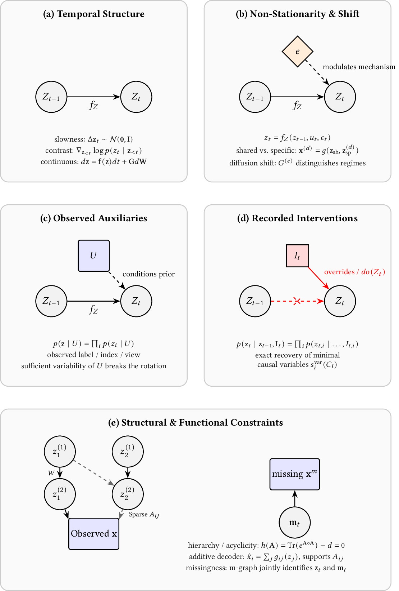
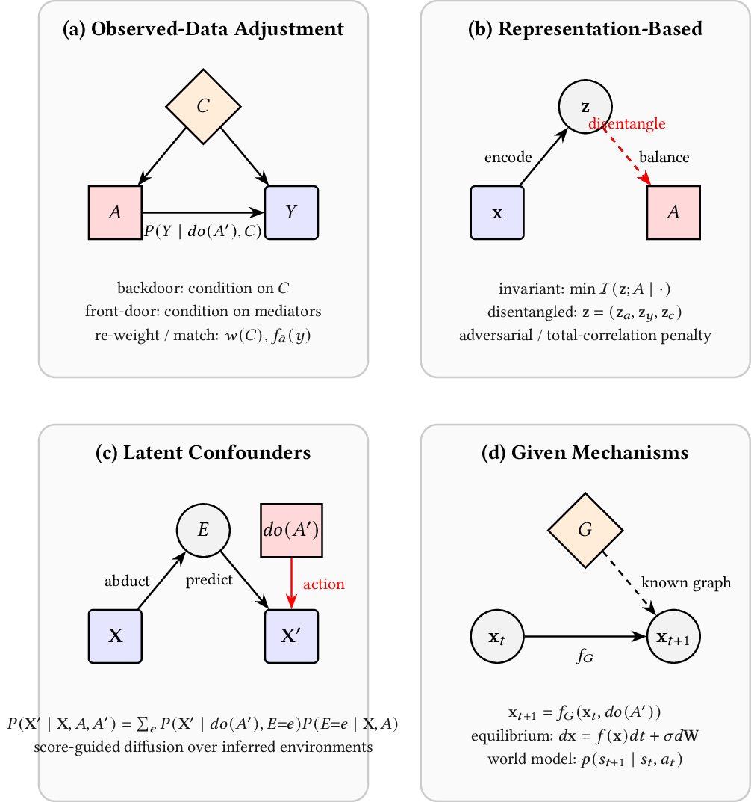
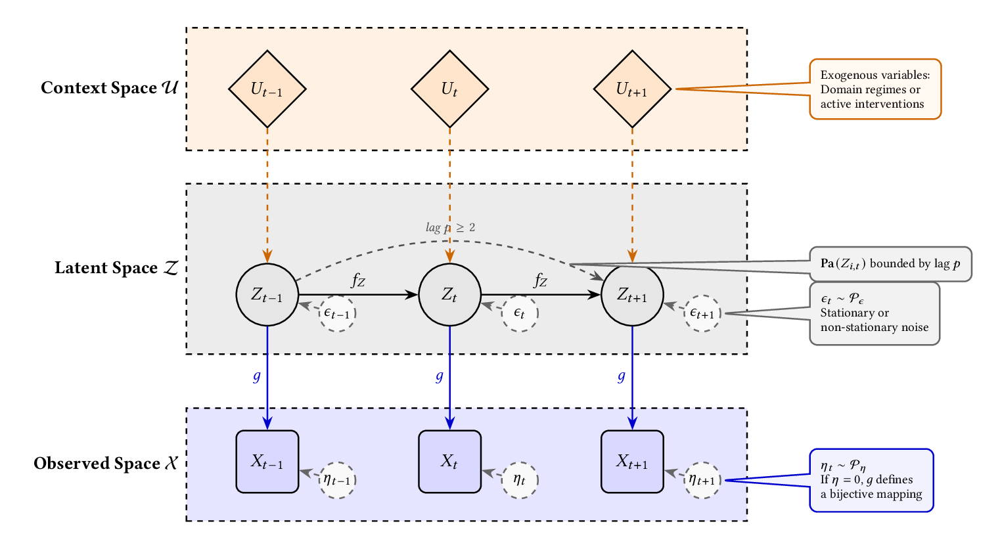

# gcmts — Generative Causal Modelling for Time Series

`gcmts` is a research-grade Python library for **generative causal modelling of
time series**. It implements the most important algorithms for (i) learning
*identifiable* causal representations from sequential data, (ii) estimating
counterfactual and treatment effects under time-varying treatments, and (iii)
disentangling static from dynamic causal factors for robust generalisation.

The library accompanies the manuscript *"Generative Causal Modelling in Time
Series: An Experimental Review and Benchmark"* and follows a single organising
principle:

> **The choice of dataset is dictated by the causal quantity the model claims to
> recover, and the choice of metric is dictated by the level of Pearl's causal
> hierarchy the model claims to answer.**

Every method therefore declares the causal level it targets and the ambiguity
class under which its solution is identifiable, and every evaluation uses only
metrics whose ground truth actually exists.

---

## Table of contents

1. [Background](#background)
2. [Features](#features)
3. [Installation](#installation)
4. [Quick start](#quick-start)
5. [Architecture](#architecture)
6. [Implemented methods](#implemented-methods)
7. [Evaluation](#evaluation)
8. [Benchmarks](#benchmarks)
9. [Taxonomy coverage](#taxonomy-coverage)
10. [Extending the library](#extending-the-library)
11. [Reproducibility](#reproducibility)
12. [Limitations and roadmap](#limitations-and-roadmap)
13. [Citation](#citation)
14. [License and third-party notices](#license-and-third-party-notices)

---

## Background

### The three paradigms

`gcmts` mirrors the three paradigms of the companion review:

| Paradigm | Goal | Causal level | Module |
| --- | --- | --- | --- |
| **Identifiable CRL** | Recover latent causal variables/mechanisms from `x = g(z)` up to an ambiguity class | L1 / L2 | `causal_representation_learning` |
| **Effect estimation** | Estimate `P(X \| do(A=a))` and counterfactual trajectories | L2 / L3 | `effect_estimation` |
| **Static–dynamic** (CRL sub-branch I.B.2) | Separate invariant from varying causal factors | L1 (generalisation) | `static_dynamic_disentanglement` |

### Paradigm taxonomies

The five branches of **Causal Representation Learning**, by the primary source of
the identification constraint (I.A–I.E):



The four identification strategies of **Counterfactual & Treatment-Effect
Estimation** (II.A–II.D):



### Latent temporal structural causal model

The shared generative model is the *latent temporal SCM* (L-TSCM):

```
z_{i,t} = f_i( Pa(z_{i,t}), u_t, ε_{i,t} ),      ε_{i,t} ~ p_ε
x_t     = g( z_t, η_t ),                            η_t     ~ p_η
```

where `Pa(·)` are the causal parents within a maximum lag `p`, `u_t` is an
exogenous context (regime, domain, or intervention), `g` is an unknown mixing
map, and the contemporaneous subgraph is a DAG. `TSCM` and `LTSCM` in
`gcmts.core.tscm` implement forward simulation, noise re-sampling, and
interventions for this model.



*Context `u_t`, latent `z_{i,t}` and observed `x_{i,t}` states unrolled over time;
`f` the latent mechanism, `g` the mixing (decoder) map, `ε` process noise and `η`
observation noise, with parents bounded by lag `p`.*

### Pearl's hierarchy

1. **L1 — Association:** `P(X_{1:T} | A_{1:T}=a)`.
2. **L2 — Intervention:** `P(X_{1:T} | do(A_{1:T}=a))` via the truncated
   factorisation (g-formula).
3. **L3 — Counterfactual:** `P(X'_{1:T} | X_{1:T}=x, A=a, A'=a')` via
   abduction → action → prediction.

A method is evaluated only at the level it claims. `BaseModel.causal_level()`
reports this, and `CrlBenchmarkRunner` / `EffectBenchmarkRunner` /
`DisentanglementBenchmarkRunner` enforce it.

---

## Features

- **One abstract base per paradigm** — `BaseCausalRepresentationLearner`,
  `BaseEffectEstimator`, `BaseStaticDynamicDisentangler` — with a uniform
  `forward` / `loss` / `identifiability_statement` / `ambiguity_class` contract.
- **Reusable core** — MLPs and Gaussian heads, an exponential-family conditional
  prior, invertible affine-coupling flows (RealNVP), gradient reversal, DAG
  sampling and the NOTEARS acyclicity constraint, Euler–Maruyama integration, and
  the closed-form Bures/Wasserstein-2 distance.
- **Reproducible synthetic benchmarks** — generators that reproduce each
  method's generative assumptions, with ground-truth latents, graphs,
  intervention targets, and regimes.
- **Evaluation at the right level** — a metric registry (`MCC`, `R²_diag`,
  `SHD`, `PEHE`, `ATE`, `CF MAE`, `OOD MSE`, …) plus benchmark runners.
- **Logging trainer** — `SimpleTrainer` with deterministic batching, device
  selection (CPU/CUDA/MPS), gradient clipping, a budget-free adaptive schedule
  (linear warm-up then validation-plateau decay) plus the fixed-budget
  `cosine`/`plateau`/`step`/`none` options, very permissive early stopping with
  optional best-weight restoration, exponential moving average of the weights,
  optional CUDA mixed precision (`torch.autocast` + `GradScaler`), KL warm-up
  (`beta` annealing) for the VAE methods, and per-epoch history.
- **Statistics** — Holm-corrected paired Wilcoxon tests, Friedman/Nemenyi
  rankings with critical-difference diagrams, and reproducible percentile
  **bootstrap confidence intervals** for every reported mean.
- **Training curves** — `save_training_report` writes `history.json`/`.csv` and
  a loss/terms/learning-rate figure to `outputs/<experiment>/`.
- **Typed and tested** — `mypy --strict` and `ruff` clean; a `pytest` suite
  covering flows' invertibility, graph operators, solvers, and every method's
  forward/loss/gradients plus latent-recovery sanity checks.

---

## Installation

Python **3.14** is required.

```bash
# with uv (recommended)
uv add "git+https://github.com/JoaquinMateos/GenCausModTS"

# with pip
pip install "git+https://github.com/JoaquinMateos/GenCausModTS"
```

For development:

```bash
git clone https://github.com/JoaquinMateos/GenCausModTS
cd gcmts
uv sync --extra dev
```

---

## Quick start

Train iVAE on a nonlinear-ICA benchmark and score latent recovery:

```python
from gcmts.causal_representation_learning.methods import IVAE
from gcmts.core import SimpleTrainer
from gcmts.data.synthetic import NonlinearICAGenerator
from gcmts.evaluation import BenchmarkTask, CrlBenchmarkRunner

# regime-conditioned nonlinear ICA data with ground-truth latents
data = NonlinearICAGenerator(
    observed_dim=6, latent_dim=3, horizon=1, n_regimes=3, mixing="linear", seed=0
)
model = IVAE(observed_dim=6, latent_dim=3, u_dim=3, obs_noise=0.1)

# warmup + cosine schedule, validation monitoring, per-epoch history
history = SimpleTrainer(
    max_epochs=2000, batch_size=256, val_size=512, scheduler="cosine", seed=0
).fit(model, data)

task = BenchmarkTask(
    name="ivae", model=model, data=data.sample(2048),
    metrics=["mcc", "r2_diag"], causal_level="L1_association",
)
print(CrlBenchmarkRunner().run(task).to_dict())
```

---

## Architecture

```
src/gcmts/
├── core/                              # shared, paradigm-agnostic building blocks
│   ├── base.py                        # BaseModel, BaseTrainer, device resolution
│   ├── tscm.py                        # TSCM, LTSCM forward simulators
│   ├── backbones.py                   # MLP, GaussianHead, ExpFamilyPrior, RealNVP, GRL
│   ├── graph_ops.py                   # sample_dag, acyclicity (NOTEARS), SHD, topo-sort
│   ├── solvers.py                     # euler_maruyama, bures_w2 / gaussian_w2
│   ├── trainer.py                     # SimpleTrainer (logging, batching, move_batch)
│   └── utils.py                       # MCC, Hungarian matching
├── causal_representation_learning/    # base.py + methods/
├── effect_estimation/                 # base.py + methods/ (interface + stubs)
├── static_dynamic_disentanglement/    # base.py + methods/ (SYNC, DANN, ERM)
├── data/                              # synthetic generators and loaders
├── evaluation/                        # metrics registry + benchmark runners
└── typing.py                          # Batch, outputs, ambiguity classes
```

All methods inherit from the base of their paradigm and are trainable through
`SimpleTrainer`; all data generators return a `Batch(x, z, context, mask)` that
carries ground-truth latents and context (regimes `u`, intervention targets `I`).

---

## Implemented methods

All five **CRL branches** of the review are covered.

| Branch | Method | Ambiguity class | Reference |
| --- | --- | --- | --- |
| I.A Temporal structure | Slow Flows | linear demixing | Pineau et al., 2020 |
| I.A Temporal structure | CEGEN | exact drift/volatility (no mixing) | Remlinger et al., 2021 |
| I.B Non-stationarity & environment shift | LEAP | permutation + component-wise invertible | Yao et al., 2021 |
| I.B Non-stationarity & environment shift | TDRL | permutation + component-wise invertible | Yao et al., 2022 |
| I.B Non-stationarity & environment shift | NCTRL | permutation + component-wise invertible | Song et al., 2023 |
| I.C Observed auxiliary variables | iVAE | permutation + component-wise invertible | Khemakhem et al., 2020 |
| I.D Recorded interventions | CITRIS | element-wise invertible | Lippe et al., 2022 |
| I.E Structural & functional constraints | MOSAIC | permutation of module supports | Fan et al., 2026 |

### iVAE — identifiable VAE
Learns `x = g(z) + η` with an auxiliary-conditioned, factorised exponential-family
prior `p(z|u) = ∏_i p(z_i|u)`. Trained by maximising the ELBO. Identifiable up to
permutation and component-wise invertible transforms when `u` has sufficient
variability.

### LEAP — temporal iVAE
Replaces the iVAE prior with a non-stationary causal-process prior
`p(z_t | z_{t-p:t-1}, u_t)`. Identifiability follows from linear independence of
the log-density gradients across regimes.

### TDRL — factorised temporal representation
Splits the latent space into a fixed-dynamics block, a transition-shift block
(conditioned on a domain factor), and an observation-shift block generated from a
domain factor independently of the past (`x = g(z)`). Recovers each block up to
permutation and component-wise transforms.

### NCTRL — unknown regimes
Latent regimes `c_t` follow a first-order hidden Markov model and the transition
is regime-dependent, `p(z_t | z_{t-1}, c_t)`. The discrete regimes are
marginalised exactly with the forward algorithm, giving component-wise
identifiability from observations alone.

### Slow Flows — time-series source separation
A volume-preserving normalizing flow maps observations to sources, with a slow
feature prior on the temporal increments `Δz_t = z_t − z_{t-1} ~ N(0, I)`. The
sources are identified up to a linear demixing, resolvable by linear ICA.

### CITRIS — intervention-conditioned CRL
An invertible autoencoder maps observations to `M` latents assigned to `K` causal
variables plus a shared group; the transition prior is conditioned on binary
intervention targets `I`. Minimising the information in the shared group recovers
minimal causal variables up to element-wise invertible transforms.

### MOSAIC — module discovery
A sparse additive decoder `x_i = Σ_j g_{ij}(z_j) + b_i` discovers the ANOVA
main-effect supports `A_{ij} = 1{x_i depends on z_j}` up to permutation of the
latent modules, using an L1 support penalty and a regime-conditioned encoder.

### CEGEN — Deep Euler scheme
Models the process directly in observation space with the Euler step
`z_{t+1} = z_t + f_θ(z_t)Δt + G_θ(z_t)√Δt·ε_t` and trains it by matching
step-wise conditional transitions in state-space regions with the closed-form
Wasserstein-2 (Bures) distance.

Every method exposes its assumptions and ambiguity through
`identifiability_statement()` and `ambiguity_class()`.

The **effect-estimation** paradigm implements CaTSG (score-guided diffusion),
CRN (counterfactual recurrent network), GANITE (adversarial ITE) and CEPAE
(conditional-entropy-penalised autoencoder); the **static–dynamic** sub-branch
(CRL I.B.2) implements SYNC (four-way factor split), DANN and VREx (invariant prediction),
with ERM and oracle baselines. See `effect_estimation/methods/` and
`static_dynamic_disentanglement/methods/`.

---

## Evaluation

Metrics live in `gcmts.evaluation.metrics` and are indexed by causal level:

| Family | Metrics | Ground truth required |
| --- | --- | --- |
| Representation recovery | `MCC`, `R²_diag`, `R²_sep`, `DCI` | latent factors |
| Structural recovery | `SHD`, `WSHD` | latent graph |
| Intervention recovery | `triplet`, `two_sample` | intervention targets |
| Counterfactual/treatment | `PEHE`, `ε_ATE`, `CF MAE/MBE`, `MMD²`, `J-FTSD` | counterfactuals |
| Generalisation | `OOD MSE/MAE`, domain-ID accuracy, `MIG`, `CDS` | held-out regimes |

`MCC` is invariant to permutation and monotone rescaling (the empirical
signature of identifiability); `R²_diag` matches components by correlation before
scoring. The benchmark runners move data to the model's device and compute only
the requested metrics.

Statistical comparison lives in `gcmts.evaluation.stats`: Holm-corrected paired
Wilcoxon signed-rank tests paired by `(problem, seed)`, the Friedman omnibus
test, and the Nemenyi post-hoc test with the critical difference
`CD = q_α √(k(k+1)/6N)` and Demsar-style CD diagrams.

Loaders with ground-truth causal quantities (rule R1): the tumour-growth
simulator (`data.semi_synthetic.TumourGrowthSimulator`), IHDP (100
replications), ACIC (hand-download layout), and the Voronoi/Causal Pinball SCM
(`data.voronoi.VoronoiGenerator`). A differentiable Causal3DIdent image
surrogate with known factors and interventions lives in
`data.causal3dident.py`, with CNN encoder/decoder backbones in
`core.backbones`.

---

## Benchmarks

The suite trains every method under one protocol on synthetic processes that
expose causal ground truth, then writes the paper's LaTeX tables. A single
orchestrator drives all of it.

### Recommended recipe: all the data, then the full run

Two commands. The first prepares **all** the data (downloaded datasets + the
materialised synthetic pools) on a CPU box; the second runs the whole benchmark
with every implemented training technique enabled.

**1 — download and generate all the data** (one-off; CPU only, no GPU needed):

```bash
uv run python scripts/download_datasets.py                                     # real series, IHDP, effect cohorts
uv run python scripts/generate_synthetic_data.py --clean --seeds 10 --with-grid
```

`--clean` wipes any previous synthetic generation, `--seeds 10` must match the
run, and `--with-grid` is only needed if you run the grid. (Add
`download_datasets.py --generate` for the legacy Voronoi tensors.)

**2 — run the full suite with every training technique on** (adaptive schedule,
permissive early stopping, weight EMA, KL/`beta` warm-up, best-weight restore,
plus the result-neutral data-pipeline switches):

```bash
export GCMTS_PREFETCH=1 GCMTS_LIGHT_BATCH=1     # result-neutral: overlap generation / copy less
export GCMTS_EARLY_STOPPING_PATIENCE=300        # applies to every family
export GCMTS_EMA_DECAY=0.99                     # applies to every family
# export GCMTS_AMP=1                            # optional: ~neutral here (small models)

uv run --extra tracking python scripts/run_full_benchmark.py \
    --device cuda --gpus 1 --jobs 4 --seeds 10 --with-grid \
    --data-source pool \
    --scheduler adaptive --kl-warmup-epochs 50 --restore-best-weights
```

These techniques **change the reported numbers** relative to the plain
`cosine`/no-EMA recipe, so keep this one recipe for the whole paper and state it
(see *Training schedule and early stopping* and *Other training techniques*
below). `--scheduler` and `--kl-warmup-epochs` are forwarded to the **CRL** steps
only; the `GCMTS_*` environment variables apply to every family that uses the
shared trainer. Drop `--data-source pool` for the standard **fresh-sampling**
protocol (slower, `data`-bound); with it, step 1's pools are used as a finite,
fixed dataset (a separate protocol — see below).

Step 1 writes one `data/synthetic/<suite>/seed_XX.pt` per `(suite, seed)` plus a
`synthetic/manifest.json` audit record (sizes, hashes, generator, `max_lag`).
Copy that directory to the GPU server if you generate it elsewhere. `--train-size`
(default 65536) controls the pool size (larger is closer to fresh sampling).
`run_crl_shared.py` then loads each pool, keeps it **resident on the GPU**, trains
by resampling it, and evaluates on a **disjoint** held-out pool.

Because the training set is finite and fixed, pool runs are a **different and
finite-sample protocol** from the default fresh runs and must be reported
separately. Pool mode currently covers the CRL shared suites and the
eighteen-problem grid (the bulk of the run); the CTEE, SDD, adjacent and real
families still sample fresh and remain CPU-bound — that is expected.

Results land under `outputs/` and `outputs_shared/` (per-run rows as JSON/CSV,
aggregates, Holm-corrected Wilcoxon tests, Friedman/Nemenyi summaries and CD
diagrams), the LaTeX tables in `../latex/pic/experiments/`, and each step's
logs in `outputs/logs/`. There, every step writes a combined `*.log`, and a
failing step also gets a matching `*.error` with just its traceback/error lines;
`outputs/logs/errors.log` collects a one-line entry per failure, so
`ls outputs/logs/*.error` (or `cat outputs/logs/errors.log`) is the fastest way
to see whether anything went wrong.

### A minimal run

```bash
uv run python scripts/download_datasets.py                        # one-off: fetch datasets
uv run python scripts/run_full_benchmark.py --soft --device cuda  # ~minutes smoke run
```

Use `--suites ...` for a subset and `--with-grid` to include the
eighteen-problem statistics grid.

### Resuming an interrupted run

Every runner writes its per-run rows incrementally and is **resumable by
default**: re-running the same command loads the rows already on disk and skips
the `(case, seed)` runs that are present, continuing where you stopped.

```bash
# relaunch the whole suite; completed runs are skipped
uv run python scripts/run_full_benchmark.py --device cuda --seeds 10 --with-grid --data-source pool
```

To stop a running suite, press **Ctrl+C once**: no new steps start and the running
steps are asked to stop (`SIGTERM`); a **second Ctrl+C** force-kills them
immediately (`SIGKILL`). Either way every step is terminated cleanly (each runs in
its own process group) and no child process is left behind — just re-run the same
command to resume.

To avoid mixing incompatible results, each stem records a configuration
fingerprint — the training-relevant options plus the code revision — in
`<stem>_config.json`. If that changed (for example after updating the code), the
step **refuses to resume** rather than appending rows produced under a different
protocol; pass `--force` (also accepted by `run_full_benchmark.py`) only if you
accept the mix, or delete the `<stem>.json` to start over. Use `--no-resume` to
force a step to restart. Synthetic-data generation resumes too:
`generate_synthetic_data.py` skips datasets that already exist unless `--force`
(and `--clean` wipes the whole directory first).

### Parallelism and timing

The models are small and, under the default fresh protocol, the cost is
dominated by CPU-side data generation, so the orchestrator runs the independent
steps in a bounded pool of worker processes that share the GPU (`--jobs N`,
default auto; `--jobs 1` restores strictly-sequential behaviour). `--gpus` takes
a comma-separated list of CUDA device ids, applied to each worker through
`CUDA_VISIBLE_DEVICES`; it **defaults to `1`** (the second device), so pass
`--gpus 0` on a single-GPU host or `--gpus 0,1` on a two-GPU host (round-robin),
or `--gpus ""` to inherit the environment unchanged.

With `--data-source pool` the data bottleneck is gone and each worker is
GPU-driven. Every worker still opens its **own CUDA context** (~0.5 GB on a
Turing card), so on an 11 GB RTX 2080 Ti keep `--jobs` modest (2–4) and pin all
steps to one device with `--gpus 1`; `--jobs 1` is the safest on a small card.

Because parallel workers contend for the CPU, per-run wall-clock times (`Time
(s)` in the tables) are recorded as `--` unless you run with `--jobs 1`. The
**metrics are unaffected** and identical to a sequential run.

### Progress

Each step writes a `<stem>_progress.json` file (`done/total`, elapsed, ETA) next
to its results. With `rich` installed the orchestrator renders a live dashboard
from those files — one bar per step, overall runs done/left, and an approximate
remaining time — and otherwise falls back to a plain periodic summary.

### Track runs in the ClearML web app

[ClearML](https://clear.ml) provides a browsable web UI for the run. The hosted
service at **app.clear.ml** needs no server of your own.

**1. Get credentials.** Sign in at <https://app.clear.ml> (EU:
<https://app.eu.clear.ml>, APAC: <https://app.apac.clear.ml>), open
**Settings → Workspace → Create new credentials**, and copy the snippet.

**2. Configure the machine.** Install the extra and log in once — the wizard
writes `~/clearml.conf`:

```bash
uv sync --extra tracking
uv run --extra tracking clearml-init      # paste the API host, access key, secret key
```

**3. Run with tracking** (the `--extra` flag makes the packages available to the
worker processes too):

```bash
uv run --extra tracking python scripts/run_full_benchmark.py --device cuda --seeds 10 --with-grid
```

**4. Watch it online.** Open <https://app.clear.ml> → project **GenCausModTS**.
Each benchmark step becomes one task, with per-run metrics as charts and the
training curves.

Set `GCMTS_CLEARML_PROJECT` to rename the project, or `GCMTS_CLEARML=0` to
disable tracking. If ClearML or the network is unavailable, tracking is a no-op
and the benchmark still runs.

### GPU utilisation and how to read it

Under the fresh protocol each step regenerates its batch on the CPU, so the GPU
idles and `nvidia-smi`'s instantaneous *Volatile GPU-Util* looks low (often
single digits on an idle box). `scripts/profile_training.py` prints the per-step
time split (`data`, `forward`, `loss`, `backward`, `optim`, `sync`) and accepts
`--data-source pool`, so you can contrast the two paths:

```bash
uv run python scripts/profile_training.py --suite npvar --method iVAE --device cuda
uv run python scripts/profile_training.py --suite npvar --method iVAE --device cuda \
    --data-source pool --dataset-dir data/synthetic
```

The pool path removes the `data` term and roughly doubles throughput, but note
that these are **small models** (≈50k parameters): each step is a ~2 ms kernel
burst, so the loop is latency-bound and Util still plateaus (~60–70%) even when
perfectly fed. That is expected, not a bug — read the phase profile or
`nvidia-smi dmon -s u` over time rather than a single instantaneous sample.

Three result-neutral switches, off by default and honoured by every script, help
without changing the numbers: `GCMTS_PREFETCH` overlaps batch preparation with
compute, `GCMTS_LIGHT_BATCH` copies only what training reads to the GPU, and
`GCMTS_PROFILE` prints the phase profile. For a further speedup increase
`--batch-size` (and `steps_per_epoch`) so each kernel does more work per launch.

### Training schedule and early stopping

These small models converge in a few dozen epochs, so the historical fixed
cosine over a 1500–2000-epoch budget spends most of its time on a flat plateau
(the training-curve "cliff then flat line"). Two changes address this, both
**on by default in the CRL runners** and configurable per run:

- `--scheduler adaptive` (default): linear warm-up, then decay the learning rate
  whenever the validation loss stops improving. It needs **no known epoch
  budget**, so it behaves sensibly however long you train.
- `--early-stopping-patience 300` (default): stop after that many epochs without
  a (very small, `1e-4` relative) validation improvement. It is deliberately
  **permissive** — it only fires on a genuine plateau, so results match a full
  run while ~8× less compute is spent. Pass `0` to disable.
- `--restore-best-weights` (optional): return the validation-best weights rather
  than the final ones.

```bash
# default: adaptive schedule + permissive early stopping
uv run python scripts/run_crl_shared.py --device cuda --suite npvar --seeds 10

# exact legacy behaviour (fixed cosine, no early stopping)
uv run python scripts/run_crl_shared.py --device cuda --suite npvar --seeds 10 \
    --scheduler cosine --early-stopping-patience 0

# enable permissive early stopping for *any* runner without editing it
GCMTS_EARLY_STOPPING_PATIENCE=300 uv run python scripts/run_ctee_benchmarks.py --device cuda
```

`scripts/run_full_benchmark.py` forwards `--scheduler`,
`--early-stopping-patience`, `--restore-best-weights`, `--amp`, `--ema-decay`
and `--kl-warmup-epochs` to the CRL steps. Note these change the reported
numbers relative to a pure-`cosine` run, so keep one recipe for the whole paper
and state which was used.

### Other training techniques

Three standard techniques from the deep-learning toolbox are available and
opt-in; each targets a known weakness of this benchmark:

- **Exponential moving average of the weights** (`--ema-decay 0.99`, or
  `GCMTS_EMA_DECAY`). Averaging the iterates of a network is a cheap regulariser:
  the averaged weights are far less sensitive to the last noisy optimisation
  steps than the final iterate, so validation and test metrics are more stable
  and the ten-seed dispersion shrinks. When enabled, validation is scored with
  the averaged weights and the returned model *is* the average
  (`gcmts.core.ema.EMA`).
- **KL warm-up / `beta` annealing** (`--kl-warmup-epochs K`). The VAE-based CRL
  methods (iVAE, LEAP, TDRL, NCTRL, CHiLD, MOSAIC) often lock into a
  reconstruction-only regime in the first epochs and then sit on the plateau
  discussed above. Ramping the KL weight linearly from 0 to its configured value
  over `K` epochs lets the encoder first fit the data and then regularise, which
  is the standard remedy for posterior collapse and a precondition for
  identifiability. The trainer anneals any model exposing `kl_weight`.
- **CUDA mixed precision** (`--amp`, or `GCMTS_AMP`). Wraps the forward/loss in
  `torch.autocast(float16)` and scales the backward with a `GradScaler`. On
  Turing tensor cores this helps when the kernels are large; with the ~50k
  parameter models used here the kernels are too small for tensor cores and AMP
  is *slightly slower* (measured), so it is off by default and worth switching on
  only for larger models, wider MLPs or bigger batches.

```bash
# EMA + KL warm-up + adaptive schedule + permissive early stopping
uv run python scripts/run_crl_shared.py --device cuda --suite npvar --seeds 10 \
    --ema-decay 0.99 --kl-warmup-epochs 50

# the same switches are accepted by the orchestrator
uv run python scripts/run_full_benchmark.py --device cuda --seeds 10 --with-grid \
    --gpus 1 --ema-decay 0.99 --kl-warmup-epochs 50
```

Every reported mean is accompanied by a deterministic percentile **bootstrap
95% confidence interval** (`gcmts.evaluation.stats.bootstrap_ci`), logged next to
the Wilcoxon block and written to `<stem>_stats.json`; this closes the
"bootstrap confidence intervals are pending" item of the roadmap.

### Running on a remote GPU (e.g. RTX 2080 Ti)

- **Install.** `cd gcmts && uv sync --extra tracking` (Python 3.14). Verify the
  GPU is visible and usable before a long run:
  `uv run python -c "import torch; print(torch.cuda.is_available(), torch.cuda.get_device_name(0))"`.
  Turing (`sm_75`) needs a torch wheel that still ships that arch; if
  `--device cuda` falls back to CPU, reinstall torch for a CUDA version that
  supports it.
- **Generate on either box.** Step 1 (data generation) is CPU-only, so generate
  on the server or locally and copy `data/synthetic/` over.
- **Launch under `tmux`/`nohup`.** The orchestrator writes results incrementally
  (`*_progress.json`, per-run rows, `outputs/logs/`), so a dropped SSH session
  does not lose the run. Add `2>&1 | tee outputs/run.log` to keep the console.
- **Monitor.** `watch -n1 nvidia-smi` or `nvidia-smi dmon -s u` for utilisation;
  a live dashboard is rendered when `rich` is installed.
- **Restart safely.** `--data-source pool` refuses to run when a pool is
  missing (it never silently falls back to fresh), so the pool generation is a
  hard prerequisite.

### Determinism

Every run seeds the model and the batch sampler from `--seeds`, in **both** the
fresh and pool paths, so two runs with the same seed reproduce exactly (verify
with `--seeds 1`). Pool runs differ from fresh runs only in the data protocol,
never in model initialisation.

### Results

Each method is trained on the synthetic process matching its assumptions and is
scored with metrics that match the causal claim it makes (representation
recovery, individual and marginal effects, invariance, ...). The comparative
protocol uses ten seeds (mean±std), Holm-corrected paired Wilcoxon tests, and a
Friedman/Nemenyi ranking of the CRL methods over an eighteen-problem
configuration grid.

Everything is written to `outputs/` and `outputs_shared/`, and
`scripts/make_paper_tables.py` turns the raw rows into the LaTeX tables and
critical-difference diagrams under `../latex/pic/experiments/`.

### Current run status (ten-seed run of 2026-10-16 → 2026-10-20)

The full suite ran 36 steps; **25 completed and 11 failed**, all traceable to six
localised defects rather than to the methods. The complete blocks are CRL
A.1–A.8, A.12, A.16, A.17 and B–D plus the 18-problem grid, the temporal and
static effect-estimation suites, the real external-validity panels and the
adjacent branches. The blocked blocks are the six two-dimensional physics/control
suites (A.9–A.11, A.13–A.15), the matching-benchmark sanity check, the
static–dynamic step and the two real effect cohorts (NHEFS, Oregon).

The root causes, evidence lines, proposed code fixes and the exact rerun
commands are in
[`docs/failure_analysis_and_rerun_plan.md`](docs/failure_analysis_and_rerun_plan.md).
Two are especially worth knowing: TDRL allocates three latents for `d=2` (the
metric layer then indexes out of bounds), and the Lotka–Volterra Euler
integration can write non-finite trajectories into the fixed pool; the SDD
failure was caused by `GCMTS_LIGHT_BATCH=1` dropping the `outcome` tensor that
`SYNC` reads. Refresh the LaTeX tables after a rerun with:

```bash
uv run python scripts/make_paper_tables.py \
    --shared-dir outputs_shared --outputs-dir outputs --latex-dir ../latex
```

---

## Taxonomy coverage

```bash
uv run python scripts/taxonomy_coverage.py            # report
uv run python scripts/taxonomy_coverage.py --strict   # non-zero if any row uncovered
```

The script parses the bundled taxonomy table (`docs/taxonomy_table.tex`) and
maps each branch to its implemented method(s). All five CRL branches are
covered (5/5); the effect-estimation and adjacent branches are declared but not
yet tracked by this CRL-focused script.

---

## Extending the library

To add a method:

1. Subclass the paradigm base, e.g. `BaseCausalRepresentationLearner`.
2. Implement `forward(batch) -> CausalRepresentationOutput`,
   `loss(outputs, batch)`, `encode`, `decode`, `transition`,
   `identifiability_statement`, and `ambiguity_class`.
3. Add a synthetic generator that reproduces the method's generative
   assumptions, returning ground-truth `z` and any context (`u` / `I`).
4. Add a unit test (forward shapes, finite loss, gradient flow) and, where
   possible, a latent-recovery sanity check.
5. Register any new metric in `gcmts.evaluation.metrics` at the causal level it
   measures.

The design and roadmap are documented in [`docs/design.md`](docs/design.md).

---

## Reproducibility

- Fully synthetic benchmarks with fixed seed schedules; the latent variables,
  mechanisms, mixing map and graph are regenerated identically across methods.
- `uv.lock` is committed so environments can be reconstructed.
- Benchmark scripts log every run to `outputs/`.
- The evaluation computes only metrics whose ground truth exists (rules R1–R3).
- Every reported mean carries a deterministic percentile bootstrap 95%
  confidence interval, logged and written alongside the Holm-corrected
  Wilcoxon and Friedman/Nemenyi results.

---

## Limitations and roadmap

- **Under-tuned methods.** TDRL and NCTRL are above chance but below their
  papers' reported ranges; further architecture/tuning work is needed.
- **Statistical protocol.** The shared suites and the configuration grid run
  with ten seeds and report Holm-corrected Wilcoxon plus Friedman/Nemenyi tests
  and bootstrap confidence intervals; a tagged release with a DOI is pending.
- **Pending methods.** APPEX is not implemented; iCITRIS, GBTPL, LacaDM and
  CausalConceptTS are implemented and reported.
- **Pending benchmarks.** Six two-dimensional physics/control CRL blocks
  (A.9–A.11, A.13–A.15) are blocked by the TDRL dimension-allocation and
  Lotka–Volterra finiteness defects; the ten-seed matching-benchmark sanity and
  static–dynamic blocks need a rerun after the device fixes; the NHEFS loader
  and the Oregon archive remain; the rendered-image Causal3DIdent variant and
  the ACIC archives (hand download) are not run. See
  [`docs/failure_analysis_and_rerun_plan.md`](docs/failure_analysis_and_rerun_plan.md).

---

## Citation

If you use this library, please cite the companion review:

```bibtex
@article{mateos2026gcmts,
  title   = {Generative Causal Modelling in Time Series:
             An Experimental Review and Benchmark},
  author  = {Mateos, Joaqu{\'i}n and Moya, Antonio R. and Ventura, Sebasti{\'a}n},
  year    = {2026},
  note    = {Code: \url{https://github.com/JoaquinMateos/GenCausModTS}}
}
```

See [`CITATION.cff`](CITATION.cff) for machine-readable metadata.

---

## License and third-party notices

`gcmts` is released under the **MIT License** (see [`LICENSE`](LICENSE)). MIT is
compatible with every license of the reference implementations and dependencies
used by the project:

- **Algorithms** are implemented from the published papers, not copied from the
  authors' repositories; the code in this library is original. The companion
  paper's reference implementations are cited and, where available, released under
  MIT (LEAP, TDRL, NCTRL), BSD-3-Clause-Clear (CITRIS), or are unlicensed
  (MOSAIC, consulted only for the algorithm description).
- **Direct dependencies** are permissively licensed: PyTorch (BSD-3-Clause),
  Lightning (Apache-2.0), scikit-learn/networkx/pandas/numpy/scipy
  (BSD-3-Clause), and pydantic (MIT).

See [`THIRD_PARTY_NOTICES.md`](THIRD_PARTY_NOTICES.md) for the full list and
attribution.
